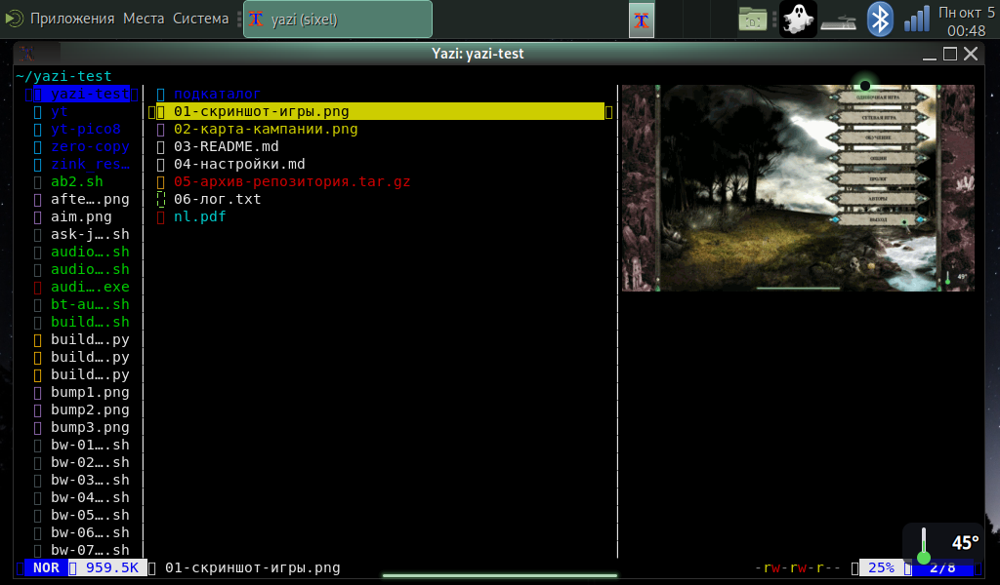
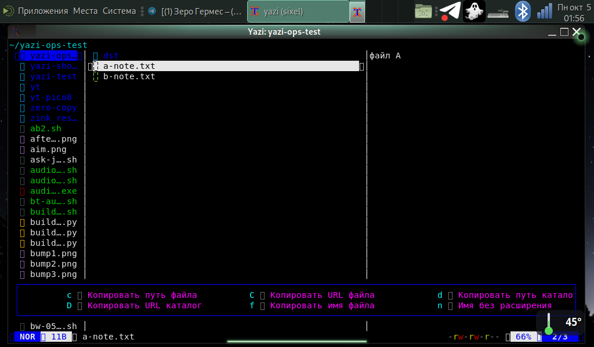
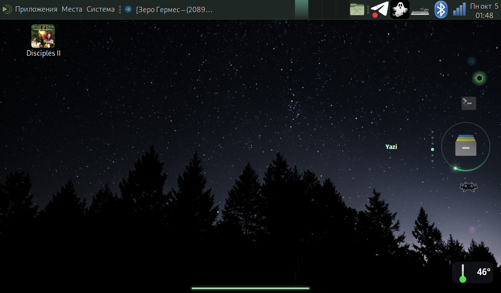

# yazi на Orange Pi Zero 3W

Установка и настройка **yazi** — быстрого консольного файлменеджера на Rust — на
**Orange Pi Zero 3W** (Allwinner A733, arm64, Debian 13 «Trixie», MATE/X11, экран 1024×600).

Здесь не пересказ документации, а то, что реально понадобилось на этой плате: **как включить
превью картинок** (в терминале MATE оно не работает «из коробки»), как вывести подсказки
**по-русски** и как поставить ярлык в карусель приложений.

## Состояние (проверено на плате 05.10.2026)

- **yazi 26.9.1** и `ya` — из официального APT-репозитория проекта (готовые сборки arm64);
- список, иконки, **превью текста с подсветкой**, превью архивов (список файлов внутри) — работают;
- **превью картинок**: пиксельные, через sixel в `xterm -ti vt340` — обёртка `yazi-sixel`
  (`Adapter: Drivers.matches: Sixel`, `sixel: true`); запасной путь — ASCII-графика chafa
  в любом терминале, обёртка `yazi-img`;
- **подсказки клавиш переведены на русский** (`~/.config/yazi/keymap.toml`, генератор в `scripts/`);
- сводка: `chafa` 1.18.3 (собрана из исходников, т.к. в Debian только 1.14.5), `fzf`, `zoxide`, `xclip`;
- файловые операции проверены на диске: копирование, перенос, удаление в корзину, переименование,
  копирование пути/имени/каталога в системный буфер.

**Превью картинки (пиксельное, sixel, xterm):**



**Русские подсказки (меню `c` — копирование):**



**Ярлык yazi в карусели приложений:**



## Быстрый путь

```bash
# 1) yazi + зависимости (официальный репозиторий, готовые сборки arm64)
PROXY=http://127.0.0.1:9697 ./scripts/install-yazi.sh
# 2) проверить, каким способом будут показываться картинки
./scripts/yazi-verify.sh
# 3) обёртки в ~/.local/bin
install -m755 scripts/yazi-sixel scripts/yazi-img scripts/*.sh ~/.local/bin/
# 4) пиксельные превью в xterm
yazi-sixel ~            # откроется xterm с yazi и настоящими превью картинок
```

Пошаговая инструкция с полным кодом всех файлов (можно ставить без `git clone`) —
**[INSTALL.md](INSTALL.md)**.

## Главная находка: почему картинки не показываются

Терминал MATE — это VTE: у него нет ни sixel, ни kitty-протокола. Порядок выбора драйвера
в yazi (`yazi-adapter/src/drivers/drivers.rs`):

1. родной протокол терминала (kitty / iTerm2 / Sixel / …) — у VTE отсутствует;
2. если задан `DISPLAY` (X11) → драйвер **X11**, а он **требует Überzug++** (`ueberzugpp`);
   без Überzug++ драйвер молча ничего не рисует и **на chafa не переключается**;
3. **chafa** (ASCII-графика) выбирается, только если `DISPLAY` пуст — и требует **chafa ≥ 1.16**,
   а в Debian 13 в репозитории 1.14.5, поэтому и этот путь не срабатывает.

Отсюда два рабочих решения:

- **xterm + sixel** (рекомендуется): `xterm -ti vt340` умеет sixel, yazi это видит сам
  (`sixel: true`), картинки пиксельные, `DISPLAY` сохраняется — работают открытие файлов
  и буфер обмена. Обёртка `scripts/yazi-sixel`.
- **chafa в любом терминале**: собрать chafa ≥ 1.16 (`scripts/build-chafa.sh`) и запускать yazi
  без `DISPLAY` — тогда yazi уходит на драйвер chafa и рисует картинку блоками Unicode.
  Обёртка `scripts/yazi-img`. Минус: внешние открыватели и xclip внутри yazi не работают.

Подробный разбор с цитатами из исходников и замерами — **[docs/FINDINGS.md](docs/FINDINGS.md)**.

## Что в репозитории

- `scripts/install-yazi.sh` — подключение официального APT-репозитория yazi и установка пакетов
  (важно: прокси нужен только для https, иначе http-зеркало Debian отдаёт 502).
- `scripts/build-chafa.sh` — сборка chafa ≥ 1.16 из исходников в `/usr/local`
  (в архиве нет `configure` — нужен пакет `libtool`).
- `scripts/yazi-sixel` — обёртка `xterm -ti vt340` + yazi: пиксельные превью, `DISPLAY` цел.
- `scripts/yazi-img` — обёртка «yazi без DISPLAY»: превью картинок через chafa в любом терминале.
- `scripts/yazi-ru-keymap.py` — генератор русских подсказок: переписывает `desc` всех привязок
  в `~/.config/yazi/keymap.toml`, сами клавиши и действия копируются из штатного keymap без изменений.
- `scripts/yazi-keys-ru.py` — собирает справочник клавиш (по-русски) из ваших настроек.
- `scripts/yazi-verify.sh` — что установлено, каким драйвером yazi покажет картинки, работает ли chafa.
- `scripts/yazi-ops-test.py` — пример автоматической проверки TUI-программы через псевдотерминал
  (копирование, перенос, удаление, переименование, копирование пути) с проверкой результата на диске.
- `docs/FINDINGS.md` — почему превью картинок не работает «из коробки», как устроен выбор драйвера,
  как проверять TUI-программы автоматически, что с корзиной.
- `docs/screenshots/` — кадры с платы.

## Ограничения

- **Диалоги и служебные надписи yazi остаются английскими** (`Rename:`, `Trash 1 file?`, `No items`) —
  у программы нет локализации интерфейса; переводятся только подсказки клавиш.
- Режим `xterm -ti vt340` меняет идентификацию терминала (VT340) — на работу других программ не влияет,
  но это не «обычный» xterm по умолчанию.
- В режиме `yazi-img` (без `DISPLAY`) внутри yazi не работают открытие файлов внешними программами
  и системный буфер обмена.
- Überzug++ (пиксельные превью в терминале MATE) не проверялся: в Debian его нет, готовых сборок
  arm64 проект не публикует, нужна сборка из исходников (C++, `libvips-dev`, X11-дев-пакеты).
- Собрано и проверено на **этой** плате и этой версии Debian; на другом железе набор библиотек
  и способ вывода картинок могут отличаться — `scripts/yazi-verify.sh` покажет фактическое состояние.

## Ссылки

- yazi — https://github.com/sxyazi/yazi, документация https://yazi-rs.github.io/docs/installation
- chafa — https://github.com/hpjansson/chafa (нужен ≥ 1.16 для запасного превью)
- Überzug++ — https://github.com/jstkdng/ueberzugpp (для драйвера X11)
- Готовые сборки yazi под Debian/Ubuntu (arm64) — https://yazi-rs.github.io/builds/
